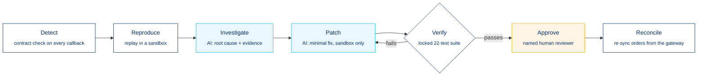

<div align="center">

# FIXCHAIN

**The autonomous reliability engineer for payment integrations.**

Detects, diagnoses, patches and verifies merchant-side payment bugs, before a paid order turns into a refund and a support ticket.

[](https://fixchain.vercel.app)
[](https://fixchain.vercel.app/landing)


*Built for Paytm merchants · independent hackathon project, not an official Paytm product · the demo uses a simulated gateway and moves no real money.*

</div>

---

## The problem

A customer pays ₹1,299. The bank is still confirming, so the gateway reports **PENDING**. A small bug in the merchant’s callback handler treats PENDING as **FAILED**. The money arrives a minute later, but the order is already final, so it stays failed.

The customer was charged with no order, the merchant raises a ticket, and the gateway gets the blame for a bug in code it doesn’t own. Today these bugs are found by customers and fixed by support tickets.

## What FIXCHAIN does



**AI where judgement helps** (diagnosing and writing the fix). **Deterministic rules wherever money is involved** (detecting, verifying, reconciling). Nothing goes live without a person’s approval.

## Operations platform: from customer complaint to verified fix

The engineering pipeline above now sits inside a full incident-operations platform (`backend/app/ops/`):

```
Customer complaint (English / Hindi / Marathi; text, voice, photo)
  → Customer Understanding → ticket persisted → Triage (rule-based severity, SLA)
  → Incident Intelligence (clustering, spike detection) → one parent incident for many tickets
  → Investigation (facts kept separate from hypotheses) → Resolution (versioned playbooks)
  → policy tiers: autonomous read-only/low-risk · human approval · human-led (fraud, freezes, filings)
  → execution → verification → customer update in their language
  → Engineering Remediation (this pipeline: reproduce · patch · locked tests · approval · post-fix replay)
  → Learning (verified outcomes → proposals a human approves) → Mission Control (live event stream)
```

- **The model never grants itself permission.** Every action has a tier; consequential ones need an approval
  bound to a SHA-256 of the exact action, with role checks and expiry. Unknown actions are denied.
- **Evidence before claims.** A ticket closes only with a named verification source; "accepted" is not "completed".
- **Simulation Lab:** five seeded, repeatable scenarios (UPI failure, Soundbox, QR, settlement, platform outage) at
  50 / 100 / 300 tickets, clearly labelled and never mixed with live data. All banks, NPCI, payment and device
  systems are mock connectors.
- **Mission Control:** customer device, agent control room and incident board side by side, driven only by
  persisted backend events.

Docs: [architecture](docs/ARCHITECTURE.md) · [agents](docs/AGENTS.md) · [data model](docs/DATA_MODEL.md) ·
[API](docs/API.md) · [deployment & troubleshooting](docs/DEPLOYMENT.md) · [demo script](docs/DEMO.md)

## Proof it works

Measured on our own runs (19–20 Nov 2026), not projected:

| | |
|---|---|
| **22/22** | independent tests pass on the verified fix, up from 10/22 on the buggy code |
| **5/5** | live AI runs ended in a verified fix, with every affected order back in sync |
| **~20 s** | from an injected bug to a verified patch on the deployed app |
| **2** | wrong AI patches caught by the verifier (11/22 and 15/22 tests) and never shipped |
| **66 + 8** | automated backend tests (37 engineering + 29 operations platform) and frontend unit tests |

## Why it’s safe to roll out

- **AI never decides a payment.** Order states change only when the merchant’s code processes a signed gateway callback.
- **Independent verifier.** A locked pytest suite the AI can’t read or edit; its SHA-256 is pinned at startup and checked before every run, in a separate process with secrets stripped.
- **Sandboxed, allow-listed fixes.** Patches are written in an isolated copy, limited to approved files, and pass a static gate (compiles, allowed imports only, no undefined names, public interface intact).
- **Validated AI answers.** A root cause must name a real function that can produce the observed state, with concrete evidence; placeholder answers are rejected and the run falls back to a labelled rule-based analysis.
- **Named human approval.** Approve, reject, rollback, reconcile and close all require a reviewer name (and optionally a token), recorded in the audit trail.
- **Knows what isn’t a bug.** Forged or mis-signed callbacks become an *external* incident; FIXCHAIN refuses to patch code that isn’t broken.
- **Scrubbed data.** Keys, signatures, card-like numbers and emails are removed from logs before any AI model sees them.

## Try it in 2 minutes

1. Open the [live demo](https://fixchain.vercel.app) and pick a role. Demo sign-in is labelled and is not production authentication. *(The free backend may take up to a minute to wake.)*
2. **Simulation Lab** → scenario **B: Soundbox failure**, 300 tickets → **Start**. Watch tickets in three languages cluster into one incident while the worker pool scales.
3. **Operational Incidents** → the copilot brief: facts, hypotheses and why the severity was chosen.
4. **Engineering Remediation** → the defect was reproduced, patched and passed 22/22 locked tests. Approve it as the approver; the root cause becomes *confirmed* and the waiting tickets close.
5. **Customer App** → chat as a merchant in Hindi or a customer in Marathi.

Full walkthrough: [docs/DEMO.md](docs/DEMO.md). The original engineering console is still available under **Engineering Remediation → Classic pipeline console**.

## Tech stack

| Layer | Technology | Where |
|---|---|---|
| API and orchestration | FastAPI, SQLite (WAL), a background state machine | `backend/app/` |
| AI agents | Sarvam AI or Claude with JSON-schema outputs, plus an offline rule-based fallback | `backend/app/agents/` |
| Independent verifier | pytest, 22 payment-correctness tests, results parsed from JUnit XML | `backend/verifier_suite/` |
| Simulated merchant | the callback handler FIXCHAIN repairs | `backend/merchant_templates/` |
| Dashboard | React 18, TypeScript, Tailwind, Recharts (Vite) | `frontend/` |
| Hosting | Render (API) and Vercel (dashboard, `/api` proxy) | `render.yaml`, `frontend/vercel.json` |

<details>
<summary><b>Project structure</b></summary>

```
fixchain/
├── backend/
│   ├── app/
│   │   ├── main.py              # FastAPI routes
│   │   ├── orchestrator.py      # pipeline state machine, approvals, reconciliation
│   │   ├── detection.py         # contract-based incident detection
│   │   ├── gateway.py           # simulated gateway (HMAC-signed callbacks)
│   │   ├── merchant_runtime.py  # loads and versions the merchant handler
│   │   ├── memory.py            # incident memory
│   │   └── agents/              # investigator, repairer, verifier, LLM wrapper, sanitiser
│   ├── merchant_templates/      # the simulated merchant code + gateway contract
│   ├── verifier_suite/          # locked, independent test suite
│   └── tests/                   # backend tests (offline, isolated)
├── frontend/
│   ├── src/                     # React dashboard (agent control room)
│   ├── public/landing.html      # landing page
│   └── vercel.json
└── render.yaml
```
</details>

## Run locally

**Backend** (API on `:8000`)

```bash
cd backend
python -m venv .venv
.venv/Scripts/python -m pip install -r requirements.txt   # macOS/Linux: .venv/bin/python
cp .env.example .env                                      # optional: add an AI provider key
.venv/Scripts/python -m uvicorn app.main:app --port 8000
```

**Dashboard** (on `:5173`)

```bash
cd frontend
npm install
npm run dev
```

Open http://localhost:5173 (dashboard), http://localhost:5173/landing.html (landing page) or http://localhost:8000/docs (API docs).

### AI provider

Put **one** key in `backend/.env` (git-ignored), never in source code:

```bash
SARVAM_API_KEY=sk_...        # Sarvam AI, model set by SARVAM_MODEL (default sarvam-105b)
# or
ANTHROPIC_API_KEY=sk-ant-... # Claude
```

With no key, the agents run in a clearly labelled *offline* mode (AST analysis plus a contract-based repair). Detection and verification are deterministic in every mode, and the dashboard shows which mode produced each result.

## Tests

```bash
cd backend
.venv/Scripts/python -m pytest -q                                              # 66 backend tests, offline and isolated
FIXCHAIN_TARGET_DIR=merchant_templates .venv/Scripts/python -m pytest verifier_suite -q   # verifier vs the clean handler
cd ../frontend && npm test && npm run build                                      # unit tests, type-check, production build
```

## Deploy

The API needs a long-running process (background pipeline, a SQLite file, pytest subprocesses), so it runs on **Render**; the static dashboard runs on **Vercel**, which proxies `/api/*` to Render so the browser talks to one origin.

1. **Render:** *New + → Blueprint* → this repo (reads `render.yaml`). Enter `SARVAM_API_KEY` when prompted, deploy, then copy the generated `FIXCHAIN_REVIEWER_TOKEN` from the service’s *Environment* tab.
2. **Vercel:** *Add New → Project* → this repo, **Root Directory** `frontend`. If your Render URL isn’t `https://fixchain-api.onrender.com`, update the rewrite in `frontend/vercel.json`.

<details>
<summary><b>Configuration reference</b></summary>

| Variable | Purpose | Default |
|---|---|---|
| `SARVAM_API_KEY` / `ANTHROPIC_API_KEY` | AI provider key (one is enough) | none: offline mode |
| `FIXCHAIN_LLM_PROVIDER` | `auto`, `sarvam` or `anthropic` | `auto` |
| `FIXCHAIN_REVIEWER_TOKEN` | token required for approve / reject / rollback / reconcile / close | none: name only |
| `FIXCHAIN_MAX_LLM_RUNS_PER_HOUR` | cost cap; extra runs use the offline agents | `0` (no cap); `20` on Render |
| `FIXCHAIN_MAX_REPAIR_ATTEMPTS` | repair attempts per run | `3` |
| `GATEWAY_WEBHOOK_SECRET` | HMAC secret for the simulated gateway | generated once into the data dir |
| `FIXCHAIN_CORS_ORIGINS` | extra browser origins allowed to call the API | localhost only |

Free-tier notes: Render sleeps after ~15 idle minutes (a scheduled GitHub Action, `.github/workflows/keep-warm.yml`, pings it every 10 minutes), and its disk resets on restart, so demo data is temporary.
</details>

## Roadmap

- Shadow-mode pilot on real webhook logs for one SDK (see the 30-day pilot plan)
- More languages and gateway contracts beyond the Python demo handler
- OS-level sandboxing for running patched code
- Live push updates in the dashboard instead of polling
- Replay of any chosen transaction in the simulator

## Team

[Team name] · [members and roles]
